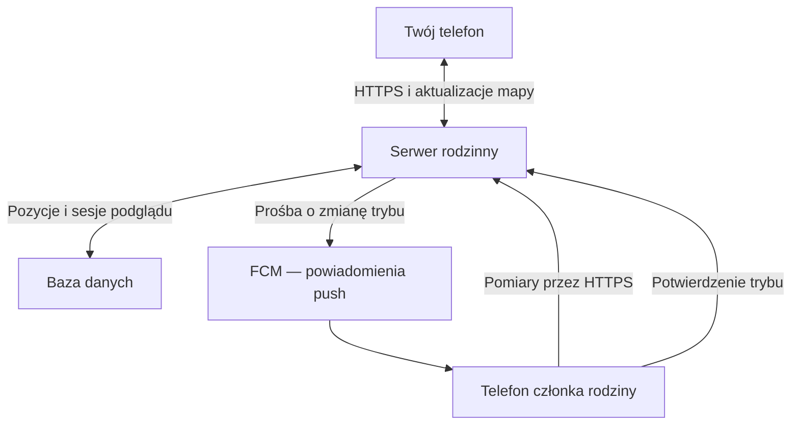

# Family Locator Concept

**Tak — taką aplikację da się zbudować i instalować prywatnie z pliku APK.** Dla Twojego zastosowania proponuję natywną aplikację na Androida, mały
serwer i dwa tryby udostępniania lokalizacji: oszczędny oraz „na żywo”.

Największym wyzwaniem będzie **niezawodne działanie na telefonie z wygaszonym ekranem**, przy rozsądnym zużyciu baterii. Mapa i obsługa kilku członków
rodziny są znacznie prostsze.

Poniżej proponuję projekt dla kilku–kilkunastu telefonów.

**Jak aplikacja działałaby z perspektywy rodziny**

Każdy instaluje tę samą aplikację, dołącza do prywatnej grupy przez jednorazowy kod lub QR i włącza udostępnianie lokalizacji. Na mapie widać członków
rodziny, godzinę ostatniego pomiaru i stan ich telefonów.

Telefon udostępniający lokalizację utrzymuje usługę z powiadomieniem „Udostępniasz lokalizację rodzinie”. Można ją zatrzymać z aplikacji lub
powiadomienia.

Proponowane ustawienia początkowe:

| Sytuacja                             | Docelowa częstotliwość | Zachowanie                                                      |
|--------------------------------------|-----------------------:|-----------------------------------------------------------------|
| Telefon pozostaje w jednym miejscu   |           Co 10–15 min | Oszczędne pomiary i okresowe potwierdzenie działania            |
| Właściciel telefonu przemieszcza się |             Co 2–5 min | Aktualizacja orientacyjnego położenia                           |
| Ktoś otwiera mapę rodziny            |             Co 15–30 s | Tymczasowe zwiększenie częstotliwości dla udostępniających osób |
| Ktoś wybiera „Obserwuj drogę”        |              Co 5–10 s | Dokładniejsze pomiary wybranej osoby                            |
| Niski poziom baterii                 |               Rzadziej | Widoczna informacja o ograniczeniu częstotliwości               |
| Udostępnianie jest wstrzymane        |          Brak pomiarów | Jednoznaczny status na mapie                                    |

To **parametry do dostrojenia podczas testów**, a nie gwarantowane odstępy. Android traktuje żądany interwał lokalizacji jako preferencję; rzeczywista
częstotliwość i dokładność zależą od urządzenia, warunków oraz ustawień
systemowych. [developers.google.com](https://developers.google.com/android/reference/com/google/android/gms/location/LocationRequest.Builder?utm_source=chatgpt.com)

Warto rozdzielić częstotliwość **mierzenia pozycji** od częstotliwości **wysyłania danych**. Samo rzadsze wysyłanie nic nie da, jeśli GPS przez cały
dzień będzie pracował w trybie wysokiej dokładności.

**Polecam komunikację przez serwer.**

Bezpośrednie połączenia między telefonami utrudniają działanie przez sieci komórkowe, obsługę rozłączeń i dostarczanie danych, gdy druga osoba nie ma
otwartej aplikacji. Serwer przechowuje ostatnią znaną pozycję i koordynuje tryb „na żywo”.

Każdy telefon pełni obie funkcje: udostępnia własną pozycję i może wyświetlać pozycje innych osób.

Proponowany zestaw komponentów:

| Element                           | Propozycja                         | Odpowiedzialność                                          |
|-----------------------------------|------------------------------------|-----------------------------------------------------------|
| Aplikacja Android                 | Kotlin + Jetpack Compose           | Mapa, lista rodziny, ustawienia, parowanie                |
| Lokalizacja                       | Fused Location Provider            | Pomiary wykorzystujące dostępne źródła lokalizacji        |
| Działanie przy zamkniętym ekranie | Foreground Service typu `location` | Utrzymywanie udostępniania i zmiana trybu pomiarów        |
| Kolejka lokalna                   | Room                               | Przechowanie niewysłanych punktów podczas braku internetu |
| Backend                           | Spring Boot w Kotlinie lub Javie   | Autoryzacja, przyjmowanie pozycji, sterowanie sesjami     |
| Baza danych                       | PostgreSQL                         | Urządzenia, członkostwo w rodzinie, ostatnie pozycje      |
| Aktualizacje otwartej mapy        | WebSocket                          | Przekazywanie nowych punktów do oglądających              |
| Powiadomienia do telefonów        | Firebase Cloud Messaging           | Sygnalizowanie prośby o częstsze aktualizacje             |
| Mapa                              | Google Maps SDK                    | Podkład mapowy, znaczniki i ślad drogi                    |
| Uruchomienie serwera              | Docker Compose na małym VPS        | Backend, baza, HTTPS i kopie zapasowe                     |

Dla tej skali wystarczy jeden backend i jedna baza. Nie ma potrzeby dodawania Kafki, Kubernetesa ani mikroserwisów.

Google Maps SDK wymaga projektu z włączonym billingiem i kluczem API. Koszt zależy od używanych funkcji i SKU, więc przed wdrożeniem trzeba sprawdzić
konkretną konfigurację; sam pomiar lokalizacji to osobny mechanizm od wyświetlania
mapy. [developers.google.com](https://developers.google.com/maps/documentation/android-sdk/usage-and-billing?utm_source=chatgpt.com)

**Przejście do trybu „na żywo” musi mieć potwierdzenie z obserwowanego telefonu.**

Przykładowy przebieg:

1. Otwierasz mapę. Od razu widzisz zapisane pozycje wraz z ich wiekiem.
2. Aplikacja tworzy na serwerze krótką sesję podglądu.
3. Serwer wysyła do telefonów sygnał, aby pobrały aktualne ustawienia sesji.
4. Działająca usługa na telefonie córki zwiększa częstotliwość pomiarów i odsyła potwierdzenie.
5. Twoja aplikacja pokazuje „Na żywo” dopiero po potwierdzeniu i otrzymaniu świeżego pomiaru.
6. Gdy zamkniesz mapę, sesja wygasa i telefon wraca do trybu oszczędnego.

Proponuję odnawianie sesji co 30 sekund i wygaśnięcie po 90 sekundach bez odnowienia. Telefon wysyłający dane również musi znać termin wygaśnięcia —
dzięki temu zakończy intensywne pomiary nawet wtedy, gdy utraci kontakt z serwerem.

Przy kilku oglądających tryb trwa, dopóki istnieje przynajmniej jedna aktywna sesja. Lokalne wstrzymanie udostępniania zawsze ma pierwszeństwo.

**FCM nie daje gwarancji natychmiastowego wybudzenia.** Zwykłe wiadomości mogą być opóźnione przez Doze. Wiadomości wysokiego priorytetu powinny
prowadzić do widocznych powiadomień; używanie ich do niewidocznego odpytywania grozi obniżeniem
priorytetu. [firebase.google.com](https://firebase.google.com/docs/cloud-messaging/android-message-priority?utm_source=chatgpt.com)

Dlatego prośba o tryb live powinna także czekać na serwerze i być sprawdzana przy kolejnym zwykłym połączeniu telefonu. Na mapie przez ten czas
zobaczysz „Oczekiwanie na telefon”, zamiast pozornego podglądu na żywo.

Dla drogi do szkoły warto dodatkowo mieć przycisk **„Udostępniaj dokładnie przez 30 minut”** na telefonie dziecka. Uruchomienie go przed wyjściem
zmniejsza zależność od późniejszego zdalnego wybudzenia.

**Ograniczenia Androida wpływają na projekt nawet przy instalacji spoza sklepu.**

Android przewiduje usługę pierwszoplanową typu `location` właśnie dla długotrwałych zastosowań, takich jak udostępnianie lokalizacji.
„Pierwszoplanowa” oznacza tu usługę widoczną dla użytkownika — ekran aplikacji nie musi pozostawać
otwarty. [Android Developers](https://developer.android.com/about/versions/14/changes/fgs-types-required?utm_source=chatgpt.com)

Trzeba uwzględnić następujące wymagania:

- **Uprawnienia lokalizacji:** lokalizacja dokładna oraz osobno rozpatrywana lokalizacja w tle. Usługa uruchomiona z widocznej aplikacji może
  kontynuować działanie po wygaszeniu ekranu; uruchamianie jej ponownie z tła podlega dodatkowym warunkom.
- **Uruchamianie usługi:** Android 12+ ogranicza start usług z tła, a Android 14+ sprawdza dodatkowo uprawnienia właściwe dla typu usługi. Samo
  uprawnienie „zawsze zezwalaj na lokalizację” nie znosi wszystkich
  ograniczeń. [developer.android.com](https://developer.android.com/develop/background-work/services/fgs/restrictions-bg-start?utm_source=chatgpt.com)
- **Ustawienia baterii:** konfigurator powinien sprawdzać ograniczenia pracy w tle i prowadzić do odpowiednich ustawień telefonu. Doze może ograniczać
  dostęp do sieci; sama usługa nie usuwa wszystkich ograniczeń
  energetycznych. [developer.android.com](https://developer.android.com/training/monitoring-device-state/doze-standby?utm_source=chatgpt.com)
- **Restart i zatrzymanie aplikacji:** trzeba przetestować wznowienie po restarcie telefonu. Po ręcznym wymuszeniu zatrzymania nie zakładamy
  automatycznego wznowienia.
- **WorkManager:** nadaje się do odroczonej synchronizacji i porządkowania danych. Okresowe zadania mają minimum 15 minut i niedokładny czas
  wykonania, więc nie mogą sterować podglądem
  live. [Background work - Android Developers](https://developer.android.com/develop/background-work/background-tasks/persistent/getting-started/define-work?utm_source=chatgpt.com)

Zakładam telefony z usługami Google Play. Urządzenie bez nich wymagałoby innego sposobu obsługi lokalizacji i powiadomień.

**Mapa powinna przede wszystkim uczciwie pokazywać jakość danych.**

Przy każdej osobie wyświetlałbym:

- czas ostatniego **pomiaru**, np. „23 sekundy temu”;
- obszar niepewności pomiaru, np. dokładność około 35 m;
- poziom baterii z ostatniego raportu;
- stan: „na żywo”, „aktualizacja okresowa”, „udostępnianie wstrzymane” albo „brak świeżych danych”.

Brak danych nie pozwala sam w sobie rozstrzygnąć, czy telefon stracił zasięg, został wyłączony, czy system zatrzymał aplikację.

Minimalny rekord lokalizacji powinien zawierać identyfikator punktu, identyfikator urządzenia, współrzędne, dokładność, czas pomiaru i czas odbioru
przez serwer. Opcjonalnie: prędkość, kierunek i baterię.

Po odzyskaniu internetu telefon wysyła zaległe punkty, ale **starszy pomiar nie może nadpisać nowszej pozycji**. Historia powinna zachować przerwy w
danych, zamiast sugerować, że rzeczywista droga została zmierzona.

W zakresie dostępu proponuję jednorazowe, wygasające zaproszenia, osobny token każdego urządzenia, możliwość jego odwołania i kontrolę członkostwa w
rodzinie po stronie serwera. Połączenia przez HTTPS, sekrety urządzenia chronione z użyciem Android Keystore. Historia opcjonalna, np. automatycznie
usuwana po 24 godzinach lub 7 dniach; współrzędnych nie zapisujemy w zwykłych logach diagnostycznych.

**Instalacja prywatna jest odpowiednia dla tego projektu.**

Przygotowujemy podpisany APK, instalujemy go na telefonach i aktualizujemy kolejnymi APK z tym samym identyfikatorem aplikacji oraz kluczem
podpisującym. Klucz trzeba zabezpieczyć i zachować. Na początek wystarczy ręczna aktualizacja; później aplikacja może informować o nowej wersji.

Trzeba też uwzględnić wdrażaną weryfikację deweloperów Androida poza Play Store. Według obecnego harmonogramu pierwsze regionalne wymagania nie
obejmują Polski, a dalsze rozszerzenie zapowiedziano na 2027 rok. Google oferuje bezpłatną ograniczoną dystrybucję do 20 autoryzowanych urządzeń —
pasującą do rodzinnego zastosowania. [developer.android.com](https://developer.android.com/developer-verification?utm_source=chatgpt.com)

**Realizację zacząłbym od testu niezawodności na dwóch Waszych telefonach.**

| Etap                    | Zakres                                                                | Kryterium ukończenia                                             |
|-------------------------|-----------------------------------------------------------------------|------------------------------------------------------------------|
| 1. Prototyp techniczny  | Usługa lokalizacji, prosty serwer, zmiana częstotliwości              | Pomiary przy wygaszonym ekranie i potwierdzone przejście do live |
| 2. Rodzinne MVP         | Mapa, zaproszenia, statusy, pauza, sesje podglądu                     | Kilka osób używa aplikacji na co dzień                           |
| 3. Odporność na przerwy | Kolejka offline, restart telefonu, ponowne łączenie, wygaszanie sesji | Przerwy są poprawnie obsługiwane i widoczne                      |
| 4. Dodatki              | Historia drogi, dom/szkoła, powiadomienia o dotarciu                  | Dopiero po sprawdzeniu niezawodności podstaw                     |

Testy powinny objąć normalny dzień, noc z wygaszonym ekranem, spacer, utratę internetu, zmianę Wi-Fi na LTE, oszczędzanie baterii i restart. Mierzymy
wiek ostatniej pozycji, czas uruchomienia live oraz dodatkowe zużycie baterii.

Mój orientacyjny szacunek dla jednej osoby mającej doświadczenie programistyczne to **kilka dni na prototyp i około 3–6 tygodni pracy na dopracowane
rodzinne MVP**. Nauka Androida i problemy konkretnych modeli mogą ten czas wydłużyć. Do planowania utrzymania przyjąłbym kilkadziesiąt złotych
miesięcznie na niewielki serwer i kopie zapasowe, osobno weryfikując koszty map.

## Koszty

**Dla Waszych trzech telefonów zakładałbym około 40–50 zł miesięcznie za wcześniej proponowany wariant z własnym serwerem.** Można też zmienić backend
na Firebase i zejść prawdopodobnie do **0–20 zł miesięcznie**. To koszty infrastruktury, bez pracy nad aplikacją i jej utrzymaniem.

**Wariant z własnym serwerem — przewidywalny rachunek**

Przykładowa kalkulacja dla małego serwera Hetzner:

| Element                                   |       Koszt miesięczny |
|-------------------------------------------|-----------------------:|
| Serwer CX23 — aplikacja backendowa i baza |           5,49 € netto |
| Publiczny adres IPv4                      |           0,50 € netto |
| Automatyczne kopie serwera                |     Około 1,10 € netto |
| **Razem**                                 | **Około 7,09 € netto** |

Ceny wynikają z cennika serwera, adresu IP oraz opłaty za backup wynoszącej 20% ceny serwera. Dostępność najtańszego modelu trzeba potwierdzić przy
zamawianiu. [Hetzner Docs](https://docs.hetzner.com/general/infrastructure-and-availability/price-adjustment/?utm_source=chatgpt.com)

Przy **założonym do kalkulacji kursie 4,30 zł/€** i doliczeniu 23% VAT wychodzi około **37,50 zł miesięcznie**. Budżet 40–50 zł daje niewielki zapas.
Rocznie: **480–600 zł**.

Pozostałe elementy:

| Element                                    |            Przewidywany dodatkowy koszt |
|--------------------------------------------|----------------------------------------:|
| PostgreSQL na tym samym serwerze           |                                    0 zł |
| Powiadomienia push FCM                     |                                    0 zł |
| Podstawowa mapa Google w aplikacji Android | 0 zł przy konfiguracji opisanej poniżej |
| Certyfikat HTTPS                           |       0 zł przy bezpłatnym certyfikacie |
| Subdomena posiadanej domeny                |                             Zwykle 0 zł |
| Internet na telefonach                     |     W ramach posiadanego pakietu danych |
| Instalowanie aktualizacji APK              |          Bez opłaty za każdą instalację |

FCM jest usługą bezpłatną. [firebase.google.com](https://firebase.google.com/pricing?utm_source=chatgpt.com)

**Doprecyzuję koszt map: zwykła mapa z Waszymi znacznikami może być bezpłatna.** Google wskazuje dla podstawowego SKU „Maps SDK” nielimitowane
bezpłatne użycie. Skonfigurowałbym mapę bez Map ID i bez dodatkowych płatnych funkcji. Map ID przełącza naliczanie na „Dynamic Maps”, a wyznaczanie
tras, wyszukiwanie miejsc czy zamiana współrzędnych na adresy mają osobne cenniki. Konto billingowe nadal jest
wymagane. [developers.google.com](https://developers.google.com/maps/billing-and-pricing/pricing?utm_source=chatgpt.com)

Rysowanie śladu drogi z otrzymanych punktów GPS nie wymaga wywoływania usługi wyznaczania tras.

**Tańsza alternatywa: Firebase zamiast własnego VPS**

Dla zaledwie trzech osób możemy zastosować Firebase Realtime Database oraz małe funkcje serwerowe obsługujące zaproszenia i wysyłanie powiadomień.

- Realtime Database ma bezpłatny limit **1 GB danych i 10 GB pobierania miesięcznie**.
- FCM jest bezpłatne.
- Funkcje serwerowe wymagają planu rozliczanego według użycia, ale mają bezpłatne limity. Mogą dochodzić drobne koszty przechowywania wdrożeń i innych
  usług. [firebase.google.com](https://firebase.google.com/docs/database/usage/billing?utm_source=chatgpt.com)

**Szacowałbym 0–20 zł miesięcznie**, przy krótkiej historii lokalizacji, rozsądnych odczytach i braku stale uruchomionych instancji. To szacunek, nie
gwarantowany darmowy abonament. Ten wariant ogranicza też pracę przy aktualizowaniu serwera i bazy.

**Największy koszt to czas programisty.** Po wdrożeniu trzeba będzie reagować na zmiany Androida, aktualizować zależności i sporadycznie diagnozować
brak lokalizacji. Powyższe kwoty nie obejmują płatnej obsługi technicznej ani wykonania aplikacji.

Dla samej rodziny **wybrałbym Firebase z budżetem 20 zł miesięcznie na start**. Własny serwer za około 40–50 zł ma większy sens, jeśli chcesz
kontrolować backend i bazę albo wykorzystać go również do innych swoich projektów.
